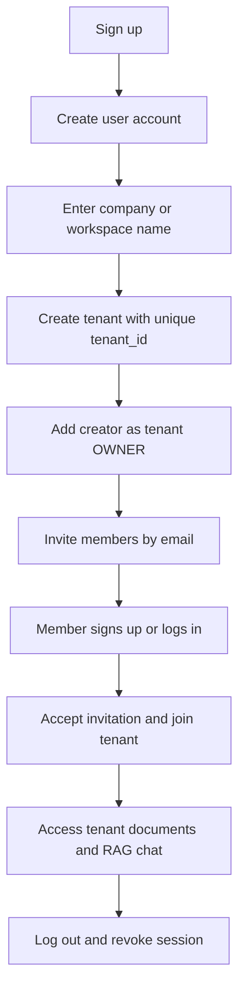
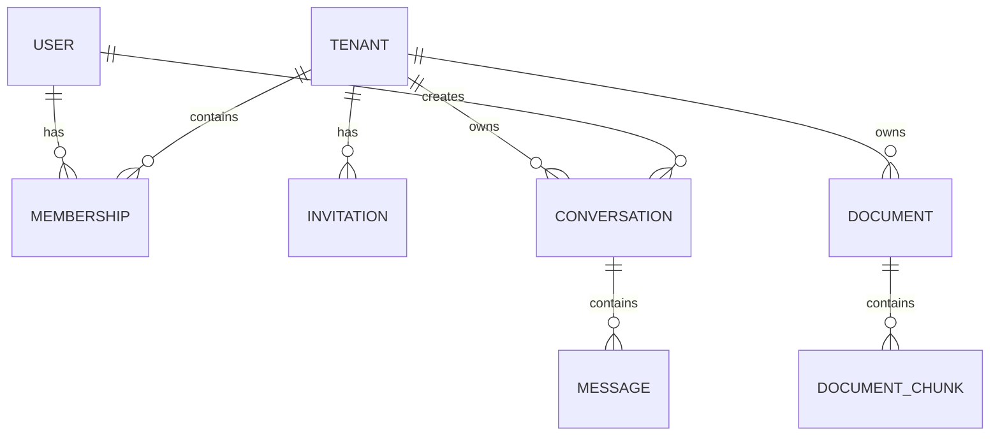

# Signup and tenant creation Flow

Implemented local API behavior and a step-by-step Swagger test are documented in
[Accounts, workspaces and Swagger testing](local-auth.md). Invitation links are
returned once to the OWNER for local testing; no email is sent. The link opens
Swagger, where the recipient pastes its token into the acceptance request.
Enterprise IdP onboarding, member administration and RAG chat remain future work.

## Signup and tenant creation

1. The first user creates an account with email and password, or through an enterprise identity provider.
2. The application creates a unique `user_id`.
3. The user enters a company or workspace name.
4. The application creates a tenant with a unique `tenant_id`. The name is a display label; it does not need to be unique and should not itself be used as the ID.
5. The application creates a membership linking the user to the tenant with the `OWNER` role.
6. The owner lands in the tenant workspace and can invite members.

Create the tenant and owner membership together in one database transaction, so a tenant cannot be left without its initial owner.

## Adding members

1. The owner enters a member’s email address and selects a role.
2. The application creates a tenant-scoped invitation with an expiration time and sends an invitation link.
3. The recipient signs up or logs in using the invited email address.
4. On acceptance, the application creates a membership for that user and tenant.
5. The invitation becomes consumed and cannot be reused.

A user can belong to more than one tenant. In that case, they keep one `user_id` and have a separate membership and role in each tenant.

For a simple first version, use two roles:

| Role | Permissions |
| --- | --- |
| `OWNER` | Manage members and tenant settings; upload, manage, and query tenant data |
| `MEMBER` | Access tenant data and use RAG, subject to any document permissions |

## Login and logout

### Login

1. The user authenticates with their identity provider or email and password.
2. The application creates a session and retrieves the user’s active memberships.
3. If they belong to multiple tenants, they select a workspace.
4. Each request is checked against the active tenant and the user’s membership before data is accessed.

### Logout

1. The user selects **Log out**.
2. The application invalidates the session and clears the session cookie or tokens.
3. The user returns to the login page.

For enterprise SSO, distinguish logging out of this application from logging out of the company’s identity provider; the latter may require a separate configuration.

## Data model

| Entity | Key fields | Purpose |
| --- | --- | --- |
| **User** | `user_id` PK, `email` unique, `name`, `auth_provider`, `created_at` | Global identity for a person |
| **Tenant** | `tenant_id` PK, `name`, `status`, `created_at` | Company or workspace |
| **Membership** | `tenant_id` FK, `user_id` FK, `role`, `status`, `joined_at` | Links a user to a tenant; unique on `(tenant_id, user_id)` |
| **Invitation** | `invitation_id` PK, `tenant_id` FK, `email`, `role`, `token_hash`, `expires_at`, `accepted_at`, `invited_by` FK | Pending membership invitation |
| **Document** | `document_id` PK, `tenant_id` FK, `name`, `storage_key`, `uploaded_by` FK, `status`, `created_at` | Tenant-owned source document |
| **Document chunk** | `chunk_id` PK, `tenant_id` FK, `document_id` FK, `content`, `vector_id` | Searchable portion of a document |
| **Conversation** | `conversation_id` PK, `tenant_id` FK, `user_id` FK, `created_at` | A user’s RAG conversation in a tenant |
| **Message** | `message_id` PK, `conversation_id` FK, `role`, `content`, `created_at` | Messages in a conversation |
| **Session** | `session_id` PK, `user_id` FK, `expires_at`, `revoked_at` | Tracks active login sessions |

Use randomly generated IDs such as UUIDs for users, tenants, and other records. Store credentials with a dedicated identity provider where practical; if passwords are managed by the application, store only securely hashed passwords.

## Tenant data separation

The critical rule is: **every data access must be constrained to a tenant that the authenticated user is allowed to access.** A `tenant_id` supplied by the browser alone is not proof of access.

- **Application and database:** Verify active membership on every request, and scope tenant-owned records and queries by `tenant_id`. Database row-level security can provide an additional enforcement layer.
- **Vector search:** Store `tenant_id` with every vector and enforce a tenant filter on every retrieval, or use separate tenant namespaces or indexes. Apply document-level permissions too if members should not all see the same documents.
- **Object storage:** Keep documents under tenant-scoped paths or containers, and authorize downloads against membership and document permissions.
- **Conversations, caches, and background jobs:** Carry and validate the tenant context throughout processing. Include the tenant in cache keys.
- **Audit logs:** Record important actions such as invitations, membership changes, uploads, and document access, with `tenant_id`, actor, action, and timestamp.

This structure supports a shared application and database while keeping each tenant’s RAG content and users logically separated.
